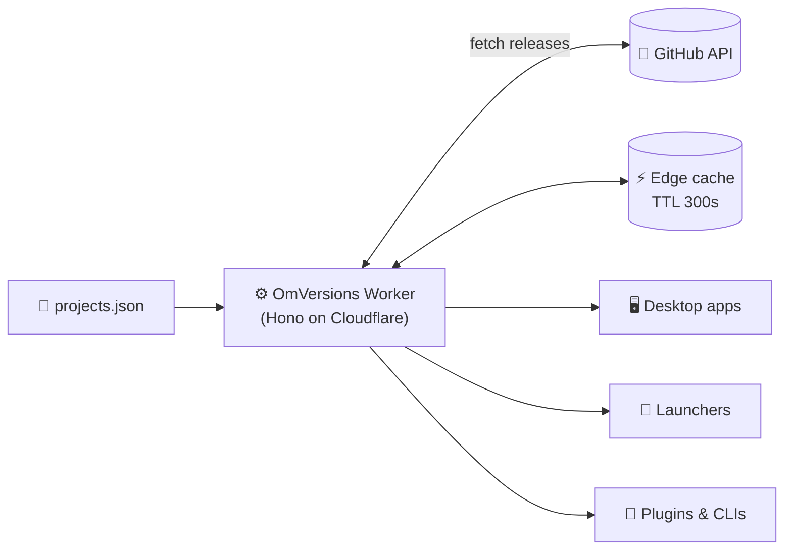
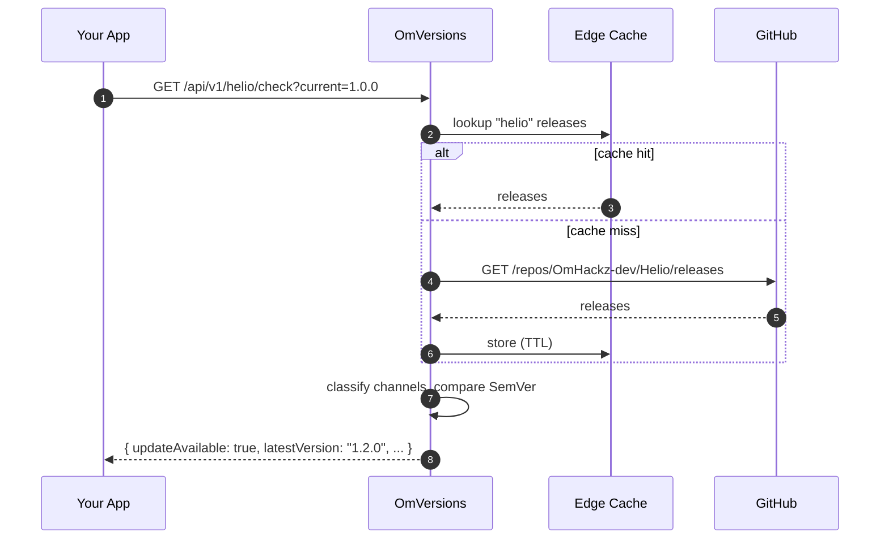
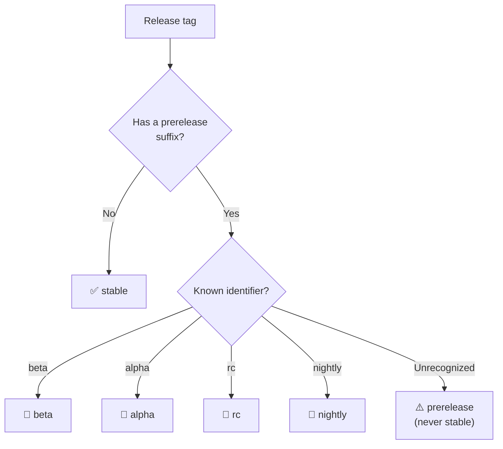
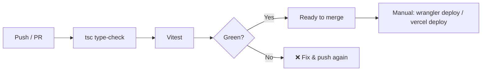

<div align="center">

# 🔖 OmVersions

**One JSON file. Every release. Zero manual version entry.**

A centralized, edge-hosted version API that automatically pulls releases from your GitHub repositories, built for desktop apps, launchers, plugins, and CLIs that need to know when an update is available.

[](https://github.com/OmHackz/OmVersions/stargazers)
[](https://github.com/OmHackz/OmVersions/actions)
[](LICENSE)
[](https://github.com/OmHackz/OmVersions/graphs/contributors)

[](https://version.omhackz.top)
[](https://vercel.com)
[](https://www.typescriptlang.org/)
[](https://hono.dev/)
[](https://vitest.dev/)

[**Live API**](https://version.omhackz.top) · [**Quick Start**](#-quick-start) · [**API Reference**](#-api-reference) · [**Integration**](#-integration-examples)

[](https://deploy.workers.cloudflare.com/?url=https://github.com/OmHackz/OmVersions)

</div>

---

## ✨ Features

| | |
|---|---|
| 🗂️ **Single source of truth** | Register a project by editing exactly one file: `projects.json`. |
| 🔄 **Automatic releases** | Versions, changelogs, and assets are pulled straight from GitHub. |
| 🧭 **Release channels** | `stable`, `beta`, `alpha`, `rc`, and `nightly`, classified from the tag. |
| 🔢 **Real SemVer** | `1.10.0` is correctly newer than `1.9.0`. Optional `v` prefix supported. |
| ⚡ **Edge-fast & cached** | Runs on Cloudflare Workers with a configurable cache TTL. |
| 🧪 **Tested offline** | The test suite mocks GitHub, so no network is needed. |
| 🔓 **MIT licensed** | Fork it, host it, ship it. |

---

## 💡 The idea

Software projects release new versions on GitHub. Apps need to know when an update exists. OmVersions removes the manual work: instead of typing version numbers, changelogs, and download links by hand, you point the API at a repository and it does the rest.



### Request lifecycle



---

## 🚀 Quick start

```bash
git clone https://github.com/OmHackz/OmVersions.git
cd OmVersions
npm install
npm run dev
```

The worker runs locally at **http://localhost:8787**.

Try it:

```bash
curl http://localhost:8787/api/v1/projects
```

---

## ⚙️ Configuration

### Add a project in 10 seconds

Edit `projects.json`:

```json
{
  "id": "myproject",
  "repo": "https://github.com/username/myproject"
}
```

Commit, push, deploy. Your project is now live at:

```
https://version.omhackz.top/api/v1/myproject/latest
```

### Full example

```json
{
  "projects": [
    {
      "id": "helio",
      "repo": "https://github.com/OmHackz-dev/Helio",
      "displayName": "Helio",
      "description": "A Minecraft launcher",
      "website": "https://example.com"
    },
    {
      "id": "mangobanks",
      "repo": "https://github.com/OmHackz-dev/MangoBanks"
    }
  ]
}
```

### Project schema

| Field | Type | Required | Description |
|-------|------|:--------:|-------------|
| `id` | `string` | ✅ | Unique identifier, normalized to lowercase. Used in API paths. |
| `repo` | `string` | ✅ | GitHub repository URL. |
| `displayName` | `string` | ➖ | Human-friendly project name. |
| `description` | `string` | ➖ | Short description. |
| `website` | `string` | ➖ | Project homepage. |

> The original two-field format (`id` + `repo`) remains fully supported.

### Environment variables

| Variable | Required | Default | Description |
|----------|:--------:|---------|-------------|
| `GITHUB_TOKEN` | No | none | GitHub API token for higher rate limits. Set via `wrangler secret put`, never commit it. |
| `RELEASE_CACHE_TTL` | No | `300` | Cache TTL in seconds. |

---

## 📡 API reference

**Base URL:** `https://version.omhackz.top/api/v1`

| Method | Endpoint | Description |
|--------|----------|-------------|
| `GET` | `/api/v1` | API metadata |
| `GET` | `/api/v1/projects` | Registered projects |
| `GET` | `/api/v1/stats` | API statistics |
| `GET` | `/api/v1/:id` | Project details |
| `GET` | `/api/v1/:id/latest` | Latest stable version |
| `GET` | `/api/v1/:id/latest?channel=beta` | Latest release for a channel |
| `GET` | `/api/v1/:id/releases` | Release history |
| `GET` | `/api/v1/:id/releases?channel=rc` | Release history filtered by channel |
| `GET` | `/api/v1/:id/releases/:tag` | A specific release |
| `GET` | `/api/v1/:id/changelog` | Latest changelog |
| `GET` | `/api/v1/:id/assets` | Latest release assets |
| `GET` | `/api/v1/:id/check?current=1.0.0` | Check whether an update exists |
| `GET` | `/health` | Health status |

### Response envelope

Every endpoint returns a consistent envelope, so clients only need one parsing path:

```jsonc
// success
{ "success": true, "data": { /* endpoint-specific */ } }

// failure
{ "success": false, "error": { "code": "INVALID_VERSION", "message": "..." } }
```

> Payloads below are illustrative. Field names inside `data` follow what the update-check example in this README consumes (`project`, `currentVersion`, `latestVersion`, `updateAvailable`, `releaseUrl`).

### `GET /:id/latest`

```bash
curl "https://version.omhackz.top/api/v1/helio/latest"
curl "https://version.omhackz.top/api/v1/helio/latest?channel=beta"
```

### `GET /:id/check`

| Query param | Required | Description |
|-------------|:--------:|-------------|
| `current` | ✅ | The version the client is running, e.g. `1.0.0` or `v1.0.0`. |
| `channel` | ➖ | Channel to compare against. Defaults to `stable`. |

```bash
curl "https://version.omhackz.top/api/v1/helio/check?current=1.0.0&channel=stable"
```

```json
{
  "success": true,
  "data": {
    "project": "helio",
    "currentVersion": "1.0.0",
    "latestVersion": "1.2.0",
    "updateAvailable": true,
    "releaseUrl": "https://github.com/OmHackz-dev/Helio/releases/tag/v1.2.0"
  }
}
```

Comparison uses proper **semantic versioning**, so `1.10.0` is correctly newer than `1.9.0`. Invalid input returns an `INVALID_VERSION` error.

### Release channels

Supported channels: `stable` (default), `beta`, `alpha`, `rc`, `nightly`.

Channels are classified from the release tag:

| Channel | Tag examples |
|---------|--------------|
| `stable` | `v1.0.0`, `1.2.0` |
| `beta` | `v1.1.0-beta.1` |
| `alpha` | `v1.2.0-alpha.2` |
| `rc` | `v2.0.0-rc.1` |
| `nightly` | `v2.1.0-nightly.20261106` |



> Unrecognized prerelease identifiers are treated as prereleases, **never** as stable.

### Errors

| Code | Meaning |
|------|---------|
| `INVALID_VERSION` | The `current` query value is not a valid semantic version. |

---

## 🧩 Integration examples

### Desktop app: check for updates on startup

```javascript
async function checkForUpdate(projectId, currentVersion) {
  const res = await fetch(
    `https://version.omhackz.top/api/v1/${projectId}/check?current=${encodeURIComponent(currentVersion)}&channel=stable`
  );
  const json = await res.json();
  if (!json.success) return null;
  return json.data; // { project, currentVersion, latestVersion, updateAvailable, releaseUrl }
}

const update = await checkForUpdate("helio", "1.0.0");
if (update?.updateAvailable) {
  console.log(`Update ${update.latestVersion} available: ${update.releaseUrl}`);
}
```

### Shell / CI

```bash
curl -s "https://version.omhackz.top/api/v1/helio/check?current=1.0.0" | jq '.data.updateAvailable'
```

### Python

```python
import requests

r = requests.get(
    "https://version.omhackz.top/api/v1/helio/check",
    params={"current": "1.0.0", "channel": "stable"},
    timeout=10,
)
data = r.json()
if data["success"] and data["data"]["updateAvailable"]:
    print("Update available:", data["data"]["latestVersion"])
```

### Add a live version badge to your own README

```md
[](https://version.omhackz.top/api/v1/myproject/latest)
```

---

## ☁️ Deployment

### One-click deploy

[](https://deploy.workers.cloudflare.com/?url=https://github.com/OmHackz/OmVersions)
[](https://vercel.com/new/clone?repository-url=https://github.com/OmHackz/OmVersions)

This clones the repo into your GitHub account, creates the Worker on your Cloudflare account, and deploys it. Afterwards, edit `projects.json` in your copy and push to redeploy.

### Manual deploy (Cloudflare Workers)

```bash
npm install
npm run build
npm run deploy
```

**Custom domain:** attach `version.omhackz.top` through the Cloudflare dashboard (Workers → Domains / Workers Routes), or add a DNS CNAME pointing to your Workers route.

**Optional GitHub token** (never committed):

```bash
wrangler secret put GITHUB_TOKEN
```

### Deploy to Vercel

OmVersions can also be deployed to Vercel using the included `vercel.json` and `api/index.ts` entrypoint:

1. Install the Vercel CLI: `npm i -g vercel`
2. Run `vercel` in the project directory and follow the prompts.
3. Set the `RELEASE_CACHE_TTL` environment variable in the Vercel dashboard if you want a custom cache TTL (default: 300 seconds).
4. Set `GITHUB_TOKEN` in the Vercel dashboard for higher GitHub API rate limits (optional).

**Custom domain:** add `version.omhackz.top` as a domain in the Vercel project settings.

### CI

GitHub Actions runs TypeScript validation and tests on every push to `main` and on pull requests. No deployment is performed automatically; deploy manually with `wrangler deploy` or `vercel deploy`.



---

## 🧪 Testing

```bash
npm run test
```

Tests mock GitHub API calls and do not require network access.

---

## 🤝 Contributing

1. Fork the repo and create a branch.
2. Make your change, and add or update tests.
3. Run `npm run test` and make sure TypeScript passes.
4. Open a pull request.

Just want your project listed? Open a PR that adds one entry to `projects.json`.

---

## ⭐ Star history

<a href="https://star-history.com/#OmHackz/OmVersions&Date">
  <picture>
    <source media="(prefers-color-scheme: dark)" srcset="https://api.star-history.com/svg?repos=OmHackz/OmVersions&type=Date&theme=dark" />
    <source media="(prefers-color-scheme: light)" srcset="https://api.star-history.com/svg?repos=OmHackz/OmVersions&type=Date" />
    
  </picture>
</a>

---

## 📄 License

Released under the [MIT License](LICENSE).

<div align="center">

Made with ☕ by [OmHackz](https://github.com/OmHackz) · Hosted at [version.omhackz.top](https://version.omhackz.top)

</div>
